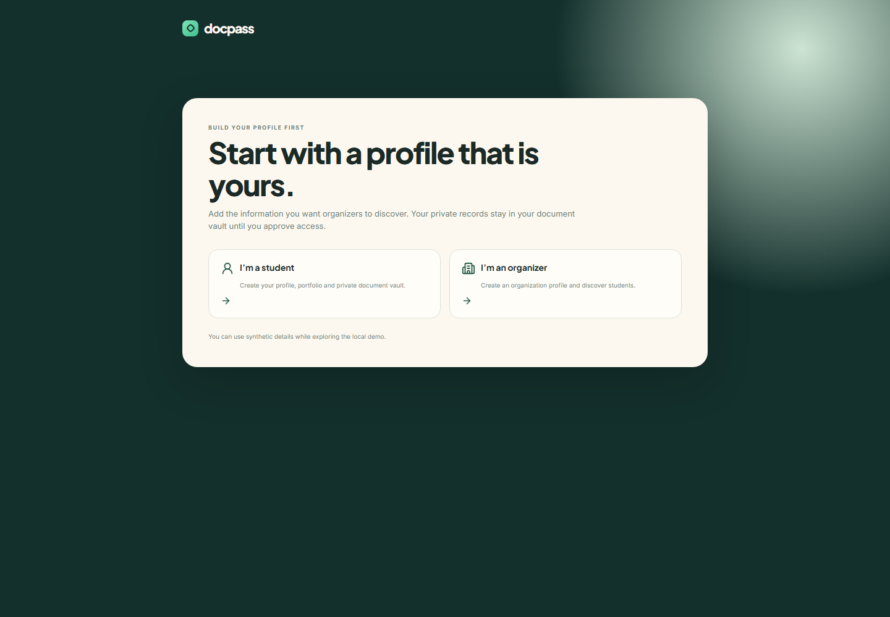
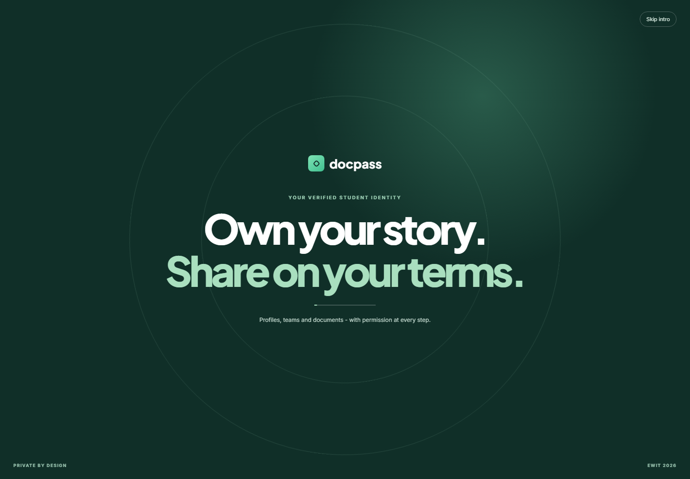
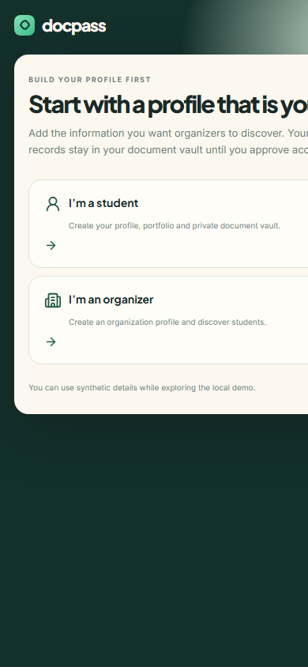

# PowerHouse East-West - DocPass

DocPass is a mobile-responsive, privacy-first platform for student profiles, teams, documents, and event discovery. Students control their information and documents, while organizers can discover talent, create events, send invitations, review accepted attendees, and export consent-approved participant data.



## Highlights

- Student onboarding with profile photo, USN, Aadhaar masking, portfolio, and a private document vault.
- Team profiles with member roles, project history, hackathon wins, certificates, and statistics.
- Organizer workspace for student/team discovery, search, filters, bulk selection, and invitations.
- Event creation with calendar date input, multi-select domain chips, and custom domains.
- Demo auto-accept flow for immediate event analytics and visuals.
- Accepted attendee analysis plus consent-approved export for Excel or Google Sheets.
- Permission-aware document sharing, profile requests, approvals, revocation, and activity history.
- Branded intro experience, full image previews, privacy watermarking, and responsive mobile layouts.

## Screen

| Welcome and onboarding |
| --- |
|  |

| Intro experience | Mobile welcome experience |
| --- | --- |
|  |  |

## Tech stack

- React 19, TypeScript, Vite
- CSS responsive layouts and Lucide icons
- Supabase schema/RLS/seed files for future production integration
- FastAPI service scaffold in `api/`

## Run locally

Requires Node.js 20.19+ or 22.12+.

```bash
npm install
npm run dev
```

Create a student or organizer profile, then use **Switch demo role** in the sidebar to test both experiences.

## Build

```bash
npm run build
npm run preview
```

The deployable static bundle is generated in `dist/`.

## Demo flow

1. Create a student profile and upload a photo.
2. Add a document or portfolio item.
3. Switch to organizer mode and filter by **Students** or **Teams**.
4. Use profile checkboxes or **Select all visible profiles**.
5. Create an event, select multiple domain chips, and invite profiles.
6. For demo purposes, invitations auto-accept. Open **Events** to view analytics and export the consent-approved attendee CSV.

## Deployment notes

This is ready to deploy as a frontend demonstration. Interactive data currently lives in the browser, so it is not yet shared between different devices or authenticated accounts. The included Supabase and FastAPI scaffolding can be used for a real production backend.

For production handling of personal data, add authentication, server-side authorization, private file storage, and database-backed records. Client-side privacy controls are not a replacement for access control.

## Project structure

```text
src/       React application and styles
public/    static assets, screenshots, and sample PDFs
supabase/  schema, seed data, and RLS migration
api/       FastAPI service scaffold
docs/      architecture and API notes
```

## License

Built for the East-West PowerHouse demonstration.
