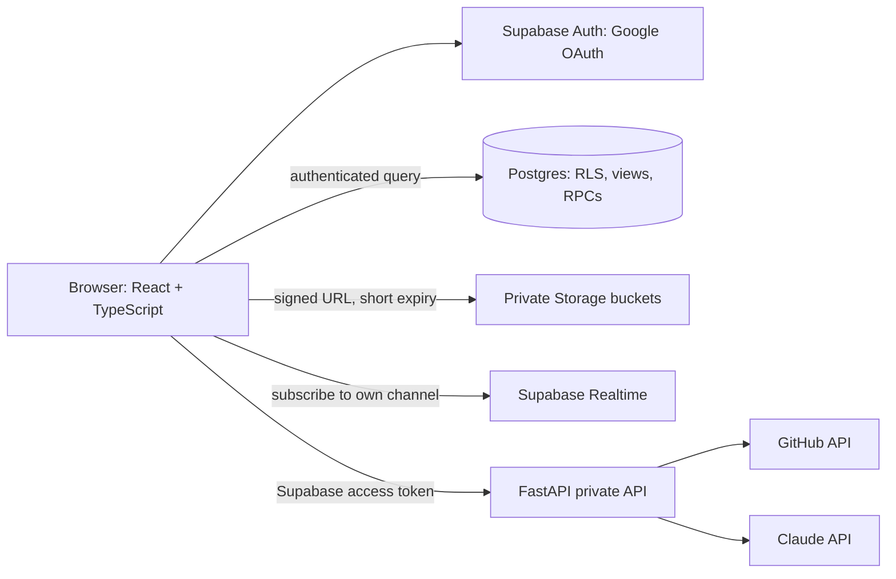

# Architecture

DocPass publishes only a small profile layer. Students own their private details and grant organizers temporary access through explicit access requests. RLS is the security boundary; blur overlays are only presentation.

## Data flow and privacy

Organizers discover profiles through `student_public`, `hackathon_public`, and `team_public`, which omit descriptions, links, USN, Aadhaar and media paths. `request_access` creates a pending grant and notification. A student or active team member decides with a bounded expiry. Queries of locked hackathon and project rows pass only while an approved request matches the target and scope. Changing status to `revoked` ends the database grant immediately. `get_locked_student` records a view before returning approved masked student details.

The frontend prototype does not yet call these Supabase objects. Its local locked overlay is an interaction demo and is not an authorization control.

## Trust boundaries

- **Browser:** user-controlled and not trusted with private keys or authorization decisions.
- **Postgres:** authoritative authorization via RLS. Direct organizer queries without a matching active grant must return no locked row.
- **Storage:** private bucket objects; issue URLs from an RPC only after grant validation, with a 60-second expiry. Already issued URLs remain usable until they expire.
- **FastAPI:** server-only keys; validates the Supabase bearer token, fetches GitHub README content and calls Claude. It validates 12-digit Aadhaar input, encrypts with AES-GCM, and returns ciphertext plus last four.

## Operational scope

Designed for a demo under 100 users. This prototype has local demo UI state and SQL policies. It does not yet wire the browser auth/session lifecycle, storage RPC, realtime subscriptions, team invitation acceptance, or persisted CRUD to Supabase.
